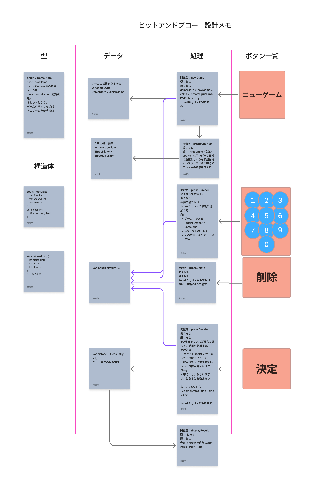

# ヒット＆ブロー

## 1. 目的
iOSアプリでヒット＆ブローを作成する。
また、プログラミング技術の上達も兼ねている。

## 2. 機能一覧
- CPUにランダムな3桁の数字（答え）を持たせる処理
- プレイヤーが0〜9のボタンで予想の数字を入力する機能
- 入力中の数字を1文字消す機能
- 予想を決定し、答えと比較して「hit」と「blow」の数を数える処理
- 結果（hit / blow）を表示する機能
- 予想の履歴を表示する機能
- 正解したときに、何回目で正解したかを表示する機能
- 新しいゲームを始める機能

## 3. 範囲

### 今回やること
- 2の機能一覧すべて
- 6の想定外のケースへの対応

### 今回はやらないこと
- データの保存（アプリを閉じたら履歴は消える）
- 予想回数の上限（何回でも予想できる）
- 桁数の変更（3桁固定）
- プレイヤーも数字を持ち、CPUと交互に当て合う対戦形式

## 4. 入力と出力

### 入力
- 数字ボタン（0〜9）：予想の数字を1つずつ入力する
- 削除ボタン：入力中の数字を最後の1文字だけ消す
- 決定ボタン：3桁そろった予想を確定する
- 新しいゲームボタン：答えを作り直し、履歴と回数をリセットする

### 出力
- 入力中の予想（数字を押すたびに更新）
- 決定したときの結果：「◯ヒット ◯ブロー」
- 予想の履歴：回数・予想した数字・ヒット数・ブロー数の一覧（新しいものを上に表示）
- 正解したとき：「正解！ ◯回目でクリア」と、答えの数字

## 5. ルール
1. 使える数字は0〜9。答えも予想も、同じ数字を2回使わない3桁とする。
2. 先頭の桁に0を使ってもよい（例：012）。
3. アプリを開いた直後はゲームが始まっておらず、新しいゲームボタンを押すとゲームが始まる。
4. ゲーム開始時に、CPUがルール1・2を満たす答えをランダムに1つ決める。答えはプレイヤーには見えない。
5. プレイヤーは3桁の予想を入力し、決定する。
6. 予想の各桁について、答えと比べる。
   - 数字と位置の両方が一致していれば「ヒット」
   - 数字は答えに含まれているが、位置が違えば「ブロー」
   - 答えに含まれない数字は、どちらにも数えない
7. 3ヒットになったら正解でゲーム終了。それ以外なら結果を表示し、ルール5に戻る。
8. 予想を決定するたびに、回数を1増やす。

## 6. 想定外のケース

| ケース | どうするか |
|---|---|
| アプリを開いた直後（新しいゲームを押す前）に、数字・削除・決定ボタンを押す | 押せないようにする（新しいゲームボタンだけ押せる） |
| すでに入力した数字のボタンを押す | 押せないようにする（使用済みのボタンはグレーにする） |
| 3桁入力したあとに、さらに数字ボタンを押す | 無視する |
| 3桁そろっていないのに決定ボタンを押す | 押せないようにする |
| 何も入力していないのに削除ボタンを押す | 何もしない |
| 正解したあとに数字ボタンや決定ボタンを押す | 押せないようにする（新しいゲームボタンだけ押せる） |
| 前と同じ予想をもう一度決定する | そのまま受け付け、回数にも数える |
| ゲームの途中で新しいゲームボタンを押す | 答えを作り直し、入力中の数字・履歴・回数をすべてリセットする |

## 7. 完成の条件（テストケース）

### 判定（答えが 371 の場合）

| 入力（予想） | 期待する結果 |
|---|---|
| 456 | 0ヒット 0ブロー |
| 123 | 0ヒット 2ブロー |
| 713 | 0ヒット 3ブロー |
| 391 | 2ヒット 0ブロー |
| 317 | 1ヒット 2ブロー |
| 371 | 3ヒット（正解） |

### 答えの作成

| 入力 | 期待する結果 |
|---|---|
| 答えを100回作る | すべて3桁で、同じ数字が入っていない |

### 操作

| 入力 | 期待する結果 |
|---|---|
| 1 → 1 | 2回目の1は押せず、入力は「1」のまま |
| 2 → 3 → 4 | 4は無視され、入力は「123」 |
| 削除 | 入力は「1」 |
| 1 → 2 → 決定 | 決定ボタンが押せない |
| 予想を3回決定して正解 | 「正解！ 3回目でクリア」と表示される |
| 正解後に新しいゲーム | 履歴が空になり、回数が0に戻る |
| アプリを開いた直後に数字ボタンを押す | 押せず、入力は空のまま |

## 8. 設計

### 処理とデータの関係

| 処理 ＼ データ | gameState | cpuNum | inputDigits | history |
|---|---|---|---|---|
| newGame | 書く | 書く | 書く（空にする） | 書く（空にする） |
| createCpuNum | − | − | − | − |
| pressNumber | 読む | − | 読む・書く | − |
| pressDelete | − | − | 読む・書く | − |
| pressDecide | 読む・書く | 読む | 読む・書く | 書く |
| displayResult | − | − | − | 読む |

- `createCpuNum` は新しい答え（`ThreeDigits`）を返すだけで、データは直接書き換えない。`cpuNum` に入れるのは `newGame`。
- 回数は `history.count` で求めるので、別のデータとしては持たない。

## 9. ロードマップ

- [x] フェーズ0：準備（リポジトリ、ブランチ、要件定義）
- [x] フェーズ1：設計
- [ ] フェーズ2：ロジックを Playground で作る
  - [ ] ヒットとブローを数える処理（7の判定表）
  - [ ] 答えを作る処理（7の答えの作成）
  - [ ] 予想の入力処理（7の操作）
  - [ ] ゲームの進行（最初から正解まで print で1ゲーム遊べる）
  - [ ] 6の想定外のケースを全部確認
- [ ] フェーズ3：ロジックをアプリ用のファイルに移す
- [ ] フェーズ4：画面（SwiftUI）を作る
- [ ] フェーズ5：仕上げ（7を全部確認、README 更新、main にマージ）

## メモ
- 「ゲーム説明」にあった「プレイヤーとCPUが一対一で対戦する」は、CPUの答えをプレイヤーが当てる一方通行の形にした。お互いに当て合う形式は「今回はやらないこと」に入れた。
- 6の対応（使用済みのボタンを押せなくする、など）は仮で決めたもの。エラーメッセージを出す形にしたくなったら変更する。
- 履歴の並び順は、設計の displayResult に合わせて「新しいものを上」にした。
- アプリを開いた直後は、新しいゲームボタンを押すまで遊べない形にした（gameState の初期値が .finishGame のため）。
- 答えとの比較は、今回は独立した関数にせず pressDecide の中で行う。テストするときは、Playground で cpuNum に答え（例：371）を直接入れてから pressDecide を呼んで確かめる。
## 9. ロードマップ

ブランチ：`feature/hit-and-blow` を親にして、各ステップのブランチを作る。
ステップが終わったら親にマージし、次のステップは親から作る。

- [x] フェーズ0：準備（リポジトリ、ブランチ、要件定義）
- [x] フェーズ1：設計

### フェーズ2：ロジックを Playground で作る
- [ ] 2-1 型とデータの土台 `step/2-1-models`
  - GameState、ThreeDigits、GuessEntry と、4つのデータ（gameState、cpuNum、inputDigits、history）を作る
  - 完了：エラーなくビルドでき、初期値を print で確認できる
- [ ] 2-2 答えを作る `step/2-2-answer`
  - createCpuNum
  - 完了：7の「答えの作成」（100回作って全部3桁・重複なし）
- [ ] 2-3 予想の入力 `step/2-3-input`
  - pressNumber、pressDelete
  - 完了：7の「操作」のうち、入力と削除に関するテストが通る
- [ ] 2-4 決定と判定 `step/2-4-decide`
  - pressDecide（比較、履歴への記録、3ヒットで終了、入力を空に戻す）
  - 完了：cpuNum を 371 にして、7の「判定」の表が全部正しく出る
- [ ] 2-5 ゲームの進行 `step/2-5-game-flow`
  - newGame、displayResult
  - 完了：print だけで最初から正解まで1ゲーム遊べる。正解後のニューゲームでリセットされる
- [ ] 2-6 想定外のケースの確認 `step/2-6-edge-cases`
  - 完了：6の表を全部試して、決めたとおりに動く

### フェーズ3：ロジックをアプリ用のファイルに移す
- [ ] 3-1 ロジックの移動 `step/3-1-move-logic`
  - 完了：移したあともフェーズ2のテストが同じ結果になる

### フェーズ4：画面（SwiftUI）を作る
- [ ] 4-1 見た目だけ作る `step/4-1-layout`
- [ ] 4-2 数字ボタンと入力中の表示 `step/4-2-input-ui`
- [ ] 4-3 決定・結果・履歴の表示 `step/4-3-result-ui`
- [ ] 4-4 ボタンを押せる・押せないの切り替え `step/4-4-button-state`
- [ ] 4-5 正解の表示とニューゲーム `step/4-5-clear-ui`

### フェーズ5：仕上げ
- [ ] 5-1 シミュレーターで7を全部確認、README 更新 `step/5-1-finish`
- [ ] `feature/hit-and-blow` を `main` にマージ
